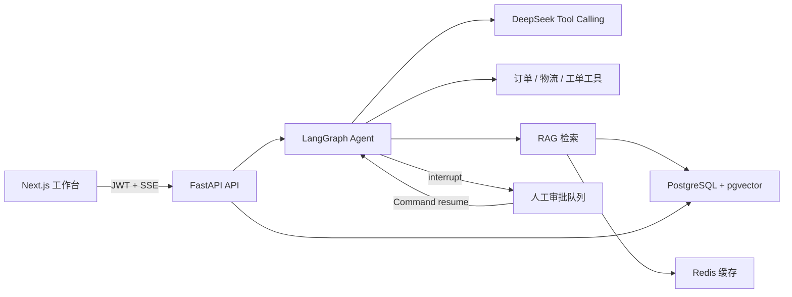

# ResolveFlow

面向企业客服场景的 RAG + Tool Calling 智能体工作台。项目把知识问答、订单查询、物流跟踪、退款审批、人工转接、工单管理和运行指标放进一条可观察、可中断、可恢复的 Agent 工作流。


## 核心能力

- **LangGraph 状态机**：规划、风险判断、工具执行、答案生成均为独立节点，会话以 `thread_id` 持久化状态。
- **RAG 双运行模式**：本地使用中文字符级 TF-IDF，生产环境使用 384 维 Hashing Embedding + pgvector HNSW 余弦检索。
- **7 个业务工具**：知识检索、订单查询、物流跟踪、退款资格计算、退款申请、创建工单、人工转接。
- **Human-in-the-loop**：退款写操作触发 LangGraph `interrupt()`；管理员审批后通过 `Command(resume=...)` 恢复原工作流。
- **实时与可观察性**：SSE 推送规划、工具轨迹和最终答案；记录工具耗时、调用结果、用户反馈和运营指标。
- **企业基础能力**：JWT 登录、角色权限、文档上传、SQLite 本地模式、PostgreSQL/pgvector + Redis 部署模式、CI 与自动化测试。

## 架构



本地模式不配置模型密钥也可完整演示。确定性路由器会根据意图调用真实工具，便于测试和面试现场运行；配置 DeepSeek 后，规划与答案生成切换为 LLM 模式。

## 技术栈

| 层级 | 技术 |
| --- | --- |
| Agent | LangChain 1.2、LangGraph 1.1、DeepSeek Tool Calling |
| 检索 | pgvector、HNSW、scikit-learn、Redis |
| 后端 | FastAPI、SQLAlchemy 2、Pydantic 2、JWT、SSE |
| 前端 | Next.js 16、React 19、TypeScript、Lucide Icons |
| 工程化 | Docker Compose、Pytest、GitHub Actions |

## 本地运行

环境要求：Python 3.13、Node.js 24。

```powershell
# 后端
python -m venv .venv
.\.venv\Scripts\python.exe -m pip install -r .\backend\requirements.txt
Copy-Item .env.example .env
Set-Location backend
..\.venv\Scripts\python.exe -m uvicorn app.main:app --reload --port 8000
```

另开一个终端：

```powershell
Set-Location frontend
npm install
npm run dev
```

访问 `http://localhost:3000`，API 文档位于 `http://localhost:8000/docs`。

演示账号：

| 身份 | 邮箱 | 密码 |
| --- | --- | --- |
| 客户 | `customer@resolveflow.dev` | `customer123` |
| 客服主管 | `admin@resolveflow.dev` | `admin123` |

推荐演示问题：

```text
查询订单 RF20260801001 的物流
请为订单 RF20260801001 申请退款
耳机坏了无法使用，请帮我创建工单
我要转人工客服
```

退款请求产生后，使用主管账号进入“人工审批”，批准后原 LangGraph 线程会继续执行并把订单更新为 `refund_requested`。

## 使用 DeepSeek

在根目录 `.env` 中填写：

```dotenv
DEEPSEEK_API_KEY=your-api-key
DEEPSEEK_BASE_URL=https://api.deepseek.com
DEEPSEEK_MODEL=deepseek-v4-flash
```
## Docker 部署

```bash
docker compose up --build
```

Compose 会启动 Next.js、FastAPI、Redis 和带 pgvector 扩展的 PostgreSQL。首次启动会自动创建 `vector` 扩展和 HNSW 索引。

## 测试

```powershell
Set-Location backend
..\.venv\Scripts\python.exe -m pytest -q

Set-Location ..\frontend
npm run typecheck
npm run build
```

当前测试覆盖登录鉴权、订单工具、SSE 事件、RAG 检索以及退款审批的中断/恢复闭环。

## 项目结构

```text
ResolveFlow/
├─ backend/
│  ├─ app/agent/          # LangGraph、工具定义与执行器
│  ├─ app/api/routes/     # REST、SSE、审批、知识库接口
│  ├─ app/db/             # SQLAlchemy 模型与演示数据
│  ├─ app/services/       # 向量化、pgvector/TF-IDF 检索、Redis 缓存
│  └─ tests/              # 后端自动化测试
├─ frontend/src/app/      # Next.js 客服运营工作台
├─ .github/workflows/     # CI
└─ docker-compose.yml
```

## 简历表述参考

> 独立设计并实现企业客服 Agent 平台 ResolveFlow，基于 LangGraph 构建可中断/恢复的工具调用状态机，集成 RAG、订单/工单工具与退款人工审批；使用 FastAPI SSE 实现执行轨迹流式返回，采用 PostgreSQL + pgvector HNSW 和 Redis 构建生产检索链路，并通过 JWT RBAC、Pytest、Docker Compose 与 GitHub Actions 完成工程化交付。

## License

[MIT](LICENSE)
