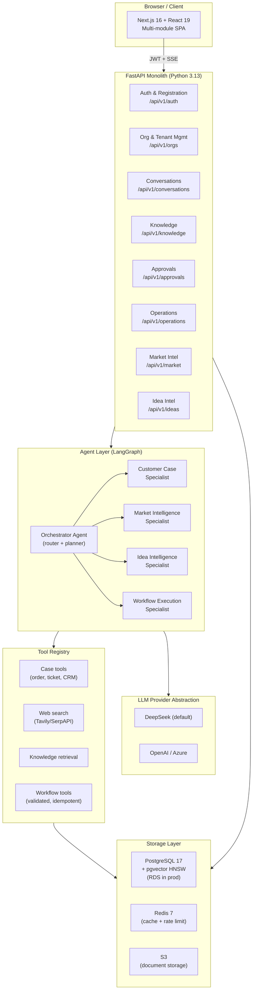
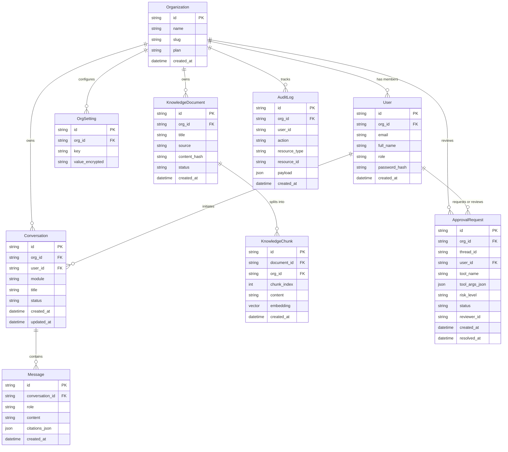
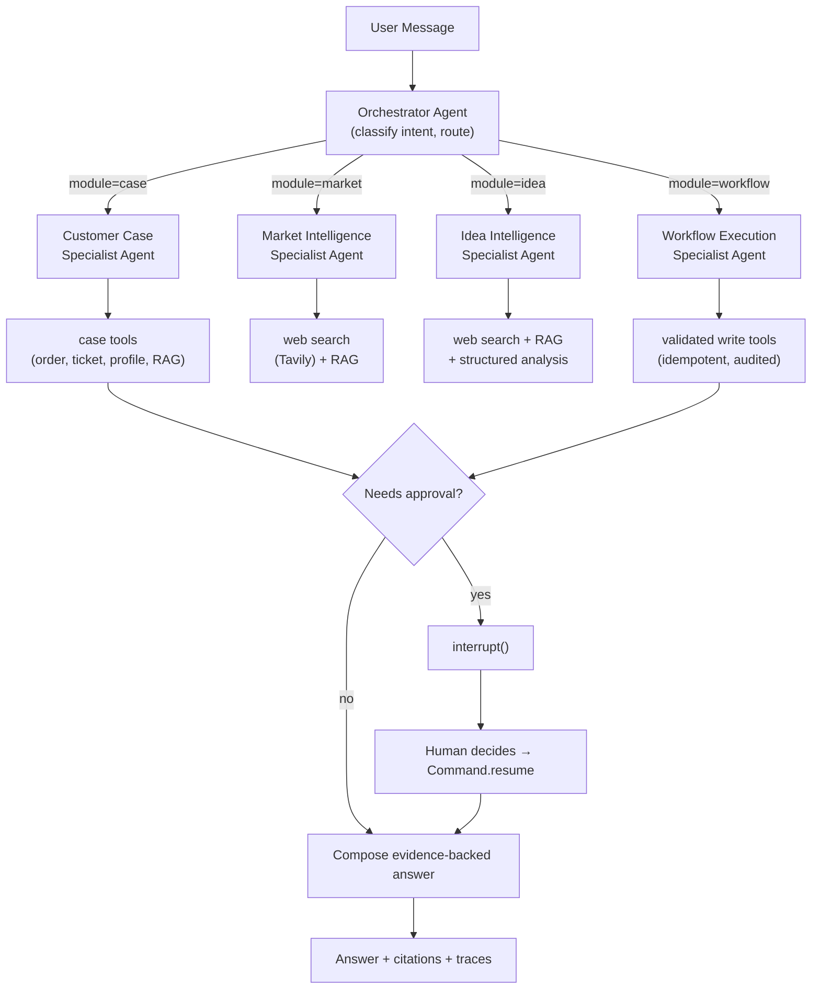

# VERITAS AI — Implementation Plan

> **Verified Enterprise Reasoning & Intelligent Task Automation System**
> Version 0.1 — Planning Phase — October 2026

---

## Executive Summary

VERITAS AI is a general-purpose, multi-tenant enterprise SaaS platform that adds evidence-grounded reasoning, multi-agent intelligence, market research, idea analysis, and safe workflow automation on top of the existing **ResolveFlow** codebase.

The repository audit finds a genuinely solid foundation: LangGraph with human-in-the-loop via `interrupt()`, PostgreSQL + pgvector, JWT auth, SSE streaming, document upload, tested approvals flow, and Docker + GitHub Actions CI. However, it is a **single-tenant, Chinese-language, customer-support–only** application with no tenant model, no org management, character-n-gram embeddings (not semantic), a volatile in-memory checkpointer, and no agents for Market Intelligence, Idea Intelligence, or Customer 360.

The plan extends the codebase in-place through nine milestones, replacing nothing that works and adding what is missing.

**Owner decisions recorded at the bottom of this document require explicit approval before implementation begins.**

---

## 1. Repository Audit

### 1.1 Verified Existing Capabilities

| Capability | Evidence |
|---|---|
| FastAPI application with CORS and lifespan | [`backend/app/main.py`](file:///d:/VERITAS_AI/backend/app/main.py) |
| JWT auth (login, `me`, role-based deps) | [`app/core/security.py`](file:///d:/VERITAS_AI/backend/app/core/security.py), [`app/api/routes/auth.py`](file:///d:/VERITAS_AI/backend/app/api/routes/auth.py), [`app/api/deps.py`](file:///d:/VERITAS_AI/backend/app/api/deps.py) |
| SQLAlchemy 2 ORM (User, Conversation, Message, Order, Ticket, ApprovalRequest, KnowledgeDocument, ToolExecution, Feedback) | [`app/db/models.py`](file:///d:/VERITAS_AI/backend/app/db/models.py) |
| SQLite (dev) → PostgreSQL (prod) dual-mode database | [`app/db/session.py`](file:///d:/VERITAS_AI/backend/app/db/session.py), [`app/core/config.py`](file:///d:/VERITAS_AI/backend/app/core/config.py) |
| pgvector HNSW index creation on startup | [`app/main.py` L29–31](file:///d:/VERITAS_AI/backend/app/main.py#L29-L31) |
| LangGraph agent graph (plan → approval? → execute → compose) | [`app/agent/graph.py`](file:///d:/VERITAS_AI/backend/app/agent/graph.py) |
| `interrupt()` + `Command(resume=...)` human-in-the-loop | [`graph.py` L111–120](file:///d:/VERITAS_AI/backend/app/agent/graph.py#L111-L120), [`approvals.py` L37](file:///d:/VERITAS_AI/backend/app/api/routes/approvals.py#L37) |
| 7 customer-support tools (search, order, shipment, refund, ticket, handoff) | [`app/agent/tools.py`](file:///d:/VERITAS_AI/backend/app/agent/tools.py) |
| RAG: TF-IDF (SQLite) + pgvector cosine (Postgres), Redis cache | [`app/services/rag.py`](file:///d:/VERITAS_AI/backend/app/services/rag.py) |
| Document ingestion (PDF via pypdf, DOCX, TXT, MD) | [`app/api/routes/knowledge.py`](file:///d:/VERITAS_AI/backend/app/api/routes/knowledge.py) |
| SSE streaming endpoint | [`conversations.py` L78–91](file:///d:/VERITAS_AI/backend/app/api/routes/conversations.py#L78-L91) |
| Metrics endpoint (conversations, tickets, approvals, tool latency) | [`app/api/routes/operations.py`](file:///d:/VERITAS_AI/backend/app/api/routes/operations.py) |
| Message feedback (thumbs up/down) | [`conversations.py` L94–108](file:///d:/VERITAS_AI/backend/app/api/routes/conversations.py#L94-L108) |
| Next.js 16 + React 19 + TypeScript + Tailwind v4 frontend | [`frontend/`](file:///d:/VERITAS_AI/frontend/) |
| Full single-page workspace UI (chat, orders, approvals, knowledge, tickets, metrics) | [`frontend/src/app/page.tsx`](file:///d:/VERITAS_AI/frontend/src/app/page.tsx) |
| SSE client-side streaming | [`frontend/src/lib/api.ts` L31–70](file:///d:/VERITAS_AI/frontend/src/lib/api.ts#L31-L70) |
| Docker Compose (postgres, redis, backend, frontend) | [`docker-compose.yml`](file:///d:/VERITAS_AI/docker-compose.yml) |
| GitHub Actions CI (pytest + typecheck + build) | [`.github/workflows/ci.yml`](file:///d:/VERITAS_AI/.github/workflows/ci.yml) |
| Specify CLI (Spec Kit v1.0.1) installed via uv | `C:\Users\hpc\AppData\Roaming\uv\tools\specify-cli\Scripts\specify.exe` |
| Seed data + offline fallback (no LLM key needed) | [`app/db/seed.py`](file:///d:/VERITAS_AI/backend/app/db/seed.py), [`graph.py` L177–217](file:///d:/VERITAS_AI/backend/app/agent/graph.py#L177-L217) |

### 1.2 Partially Implemented Capabilities

| Capability | State | Gap |
|---|---|---|
| RAG embedding | HashingVectorizer (char n-gram, 384-dim) | Not semantic; quality is poor for evidence grounding |
| Document chunking | `_chunk_count()` counts chunks but stores the whole document as a single content blob | No actual chunk splitting, no overlap |
| Role-based authorization | `customer` / `agent` / `admin` roles | No organization model; `agent` role never used in seed |
| Approvals | DB record + graph interrupt works | No reviewer assignment, no expiry, no audit log for who approved |
| Tool execution audit | `ToolExecution` table exists | No idempotency key, no pre/post verification records |
| CI | pytest + typecheck | No integration test or E2E; no linting step; no security scan |

### 1.3 Missing Capabilities

| Missing | Priority |
|---|---|
| Tenant / Organization model and tenant isolation | Critical — M2 |
| Self-service registration and org creation | Critical — M2 |
| Org-level settings, API keys, and integrations | High — M2 |
| Secure secret storage (per-org LLM key, etc.) | High — M2 |
| Audit log table | High — M2 |
| Customer 360 profile synthesis | High — M4 |
| Case timeline reconstruction and inconsistency detection | High — M4 |
| LLM provider abstraction (DeepSeek + OpenAI adapter) | High — M2 |
| Real sentence-transformer / embedding API | High — M3 |
| Proper document chunking with overlap | High — M3 |
| CSV / Excel ingestion | Medium — M3 |
| Citation-backed answer formatting with confidence levels | High — M3 |
| Market Intelligence agent + web search tool | High — M5 |
| Idea Intelligence agent | High — M6 |
| Hierarchical orchestrator + specialist worker architecture | High — M4 |
| PostgreSQL LangGraph checkpointer (durable state) | High — M2 |
| Database migrations (Alembic) | High — M2 |
| Idempotency keys on write tools | Medium — M7 |
| Post-action verification hooks | Medium — M7 |
| Evaluation harness (ragas / custom) | Medium — M9 |
| Security hardening (rate limiting, input sanitization, secrets scanning) | High — M9 |
| Cloud deployment manifests (AWS ECS/Fargate + RDS) | Medium — M9 |
| Spec Kit project initialization and workflow | Medium — M1 |

### 1.4 Technical Debt & Security Risks

| Issue | Severity | File |
|---|---|---|
| `JWT_SECRET` default `"resolveflow-local-secret-change-in-production"` | **Critical** | [`config.py` L18](file:///d:/VERITAS_AI/backend/app/core/config.py#L18) |
| Hardcoded seed passwords `customer123` / `admin123` in source | High | [`seed.py` L44,54](file:///d:/VERITAS_AI/backend/app/db/seed.py#L44) |
| `InMemorySaver` loses all agent state on restart | High | [`graph.py` L42](file:///d:/VERITAS_AI/backend/app/agent/graph.py#L42) |
| No database migrations (schema is `create_all` only) | High | [`main.py` L24](file:///d:/VERITAS_AI/backend/app/main.py#L24) |
| No rate limiting on any endpoint | High | — |
| `allow_methods=["*"]` in CORS middleware | Medium | [`main.py` L48](file:///d:/VERITAS_AI/backend/app/main.py#L48) |
| Global `runtime = SupportAgentRuntime()` singleton — not thread-safe | Medium | [`graph.py` L220](file:///d:/VERITAS_AI/backend/app/agent/graph.py#L220) |
| No request input sanitization beyond Pydantic field lengths | Medium | — |
| No tenant isolation (all queries return all rows) | Critical | All route files |
| `access_token_minutes = 720` (12-hour tokens, no refresh) | Medium | [`config.py` L20](file:///d:/VERITAS_AI/backend/app/core/config.py#L20) |
| `except Exception: pass` in agent plan/compose | Medium | [`graph.py` L105,173](file:///d:/VERITAS_AI/backend/app/agent/graph.py#L105-L173) |
| Single `page.tsx` is 349 lines — no component decomposition | Low | [`frontend/src/app/page.tsx`](file:///d:/VERITAS_AI/frontend/src/app/page.tsx) |
| No git repository initialized | Low | — |

---

## 2. Existing-vs-Required Capability Matrix

| Capability Area | Required | Exists | Gap |
|---|---|---|---|
| **Auth & Registration** | Self-service sign-up, org creation, invite | Email+password login only | Full org model + registration flow |
| **Multi-tenancy** | tenant_id isolation everywhere | None | All models + query middleware |
| **RBAC** | Owner, Admin, Analyst, Viewer, Agent roles per org | 3 global roles | 5 org-scoped roles |
| **Audit log** | Every significant action logged | ToolExecution only | AuditLog table + middleware |
| **LLM provider** | DeepSeek + OpenAI abstraction | DeepSeek only | Provider abstraction layer |
| **Agent architecture** | Orchestrator + 4 specialist agents | One flat agent | Hierarchical multi-agent graph |
| **Customer Case Intelligence** | 360 profiles, timeline, inconsistency detection | Order+ticket lookup only | Full case synthesis subgraph |
| **Market Intelligence** | Web search, competitor analysis, reports | None | Market agent + Tavily tool |
| **Idea Intelligence** | Decomposition, feasibility, risk, validation plan | None | Idea agent subgraph |
| **Knowledge Engine** | Real embeddings, chunking, citations, tenant-isolated | Char n-gram, no chunking | Embedding upgrade + chunking |
| **Workflow Automation** | Durable state, idempotency, pre/post verification | Interrupt works, InMemory | PG checkpointer + verification |
| **Document ingestion** | PDF, Word, Excel, CSV | PDF, DOCX, TXT, MD | Excel, CSV parsers |
| **Frontend** | React/Next.js multi-module | Single-page monolith | Decomposed Next.js app |
| **Testing** | Unit, integration, API, E2E, AI eval | 5 tests (API + RAG) | Full test pyramid |
| **CI/CD** | Lint, test, security, Docker push, deploy | Pytest + typecheck + build | Add lint, security, Docker push |
| **Database migrations** | Alembic managed | `create_all` only | Alembic setup + initial migration |
| **Cloud deployment** | AWS ECS Fargate + RDS | Docker Compose only | Terraform / ECS task definitions |

---

## 3. Proposed Architecture

### 3.1 System Component Map



### 3.2 Backend Module Structure

```text
backend/app/
├── agent/
│   ├── graph.py          # Orchestrator + subgraph wiring
│   ├── nodes/
│   │   ├── case.py       # Customer Case specialist subgraph
│   │   ├── market.py     # Market Intelligence specialist
│   │   ├── idea.py       # Idea Intelligence specialist
│   │   └── workflow.py   # Workflow Execution specialist
│   ├── tools/
│   │   ├── registry.py   # Tool factory, permission checks
│   │   ├── case_tools.py # Order, ticket, profile tools
│   │   ├── web_tools.py  # Tavily / SerpAPI wrapper
│   │   ├── kb_tools.py   # Knowledge retrieval tool
│   │   └── wf_tools.py   # Validated workflow tools
│   └── state.py          # Shared TypedDict state definitions
├── api/routes/
│   ├── auth.py           # Registration + login + me
│   ├── orgs.py           # Org CRUD, member invite, settings
│   ├── conversations.py  # Chat + SSE (tenant-scoped)
│   ├── knowledge.py      # Document ingest + search
│   ├── approvals.py      # HITL decisions
│   ├── market.py         # Market Intelligence requests
│   ├── ideas.py          # Idea analysis requests
│   └── operations.py     # Metrics, tickets, orders
├── core/
│   ├── config.py         # Settings (extended)
│   ├── security.py       # JWT + password hashing
│   ├── tenant.py         # Tenant context middleware
│   └── llm.py            # LLM provider abstraction
├── db/
│   ├── models.py         # All ORM models (tenant_id added)
│   ├── session.py        # Session factory
│   ├── seed.py           # English demo data
│   └── migrations/       # Alembic
├── services/
│   ├── rag.py            # Embedding + retrieval (upgraded)
│   ├── chunker.py        # Document chunking with overlap
│   ├── embedder.py       # Embedding API abstraction
│   └── audit.py          # Audit log writer
└── main.py               # App factory
```

### 3.3 Frontend Module Structure

```text
frontend/src/
├── app/
│   ├── (auth)/login/     # Login + registration pages
│   ├── (workspace)/
│   │   ├── layout.tsx    # Sidebar + nav
│   │   ├── chat/         # Conversation workspace
│   │   ├── case/         # Customer Case Intelligence
│   │   ├── market/       # Market Intelligence
│   │   ├── ideas/        # Idea Intelligence
│   │   ├── knowledge/    # Document management
│   │   ├── approvals/    # HITL approval queue
│   │   ├── tickets/      # Case management
│   │   └── metrics/      # Observability
│   └── globals.css
├── components/
│   ├── ui/               # Button, Input, Card, Badge, etc.
│   ├── chat/             # MessageBubble, CitationPanel, TracePanel
│   ├── evidence/         # EvidenceCard, SourceTag, ConfidenceBar
│   └── layout/           # PageHeader, Sidebar, EmptyState
└── lib/
    ├── api.ts            # Typed API client
    ├── types.ts          # Shared TypeScript types
    └── auth.ts           # Session management
```

---

## 4. Data Model & Tenant Isolation Strategy

### 4.1 Tenant Isolation Approach

**Shared-schema with `tenant_id` columns** on every tenant-scoped table. A SQLAlchemy session middleware injects a `tenant_id` filter on every query automatically, preventing cross-tenant data leakage.



### 4.2 Tenant Middleware Pattern

```python
# app/core/tenant.py
class TenantContext:
    """Thread-local tenant context. Set by middleware; read by queries."""
    _current: ContextVar[str | None] = ContextVar("tenant_id", default=None)

    @classmethod
    def set(cls, tenant_id: str) -> None: cls._current.set(tenant_id)

    @classmethod
    def get(cls) -> str:
        tid = cls._current.get()
        if tid is None:
            raise RuntimeError("No tenant context — missing middleware")
        return tid
```

All SQLAlchemy queries on tenant-scoped models receive an automatic `.where(Model.org_id == TenantContext.get())` filter via a reusable `TenantSession` wrapper.

### 4.3 New Roles

| Role | Scope | Permissions |
|---|---|---|
| `org_owner` | Organization | All permissions including billing and deletion |
| `org_admin` | Organization | User management, settings, knowledge management |
| `analyst` | Organization | Read all, submit intelligence requests |
| `agent` | Organization | Handle customer cases, approve/reject tickets |
| `viewer` | Organization | Read-only across all modules |

---

## 5. LLM Provider Abstraction

```python
# app/core/llm.py
class LLMProvider(Protocol):
    def chat(self, messages: list[BaseMessage], tools: list | None = None) -> BaseMessage: ...

class DeepSeekProvider:
    def chat(self, ...): return ChatDeepSeek(...).bind_tools(tools).invoke(messages)

class OpenAIProvider:
    def chat(self, ...): return ChatOpenAI(...).bind_tools(tools).invoke(messages)

def get_provider(settings: Settings) -> LLMProvider:
    if settings.llm_provider == "openai":
        return OpenAIProvider(settings)
    return DeepSeekProvider(settings)  # default
```

Org-level settings allow each tenant to provide their own API key and choose their provider. Keys are stored encrypted in `OrgSetting` (AES-256 via a KMS-backed field in production).

---

## 6. Agent Architecture

### 6.1 Hierarchical Multi-Agent Design



### 6.2 Agent State

```python
class VeritasState(TypedDict, total=False):
    # Core
    org_id: str
    user_id: str
    conversation_id: str
    module: Literal["case", "market", "idea", "workflow", "general"]
    # Input
    user_message: str
    # Planning
    intent: str
    tool_plan: list[dict]
    # Execution
    tool_results: list[dict]
    citations: list[Citation]
    traces: list[ToolTrace]
    # Approval
    approval_status: str
    pending_approval_id: str | None
    # Output
    answer: str
    confidence: Literal["high", "medium", "low", "insufficient"]
    evidence_grade: str
    mode: str
```

### 6.3 Evidence Grading Rules (Core Differentiator)

The compose node must classify every answer before returning:

- **HIGH**: Answer is fully grounded in retrieved documents or tool results with explicit citations.
- **MEDIUM**: Answer is partially grounded; some claims are estimated.
- **LOW**: Answer requires inference beyond available evidence.
- **INSUFFICIENT**: Evidence is too thin to answer safely. Agent must escalate or ask for more info.

Low and Insufficient answers must clearly disclose limitations. Agents must never fabricate data.

---

## 7. Knowledge Engine Design

### 7.1 Upgrade Path: Embeddings

**Current**: `HashingVectorizer(analyzer="char", n_features=384)` — stateless, no semantic understanding.

**Target**: OpenAI `text-embedding-3-small` (1536-dim) as default; fallback to `sentence-transformers/BAAI/bge-small-en-v1.5` (384-dim, runs locally) when no embedding API key is configured.

```python
# app/services/embedder.py
def embed(text: str, settings: Settings) -> list[float]:
    if settings.openai_api_key:
        return openai_embed(text, settings)   # 1536-dim
    return local_embed(text)                  # 384-dim BAAI/bge
```

The `KnowledgeChunk.embedding` column stores a `Vector(1536)` by default; with a fallback `Vector(384)` variant for SQLite.

### 7.2 Chunking Strategy

```python
# app/services/chunker.py
def chunk_document(text: str, chunk_size=512, overlap=64) -> list[str]:
    """Recursive character splitter with sentence-boundary awareness."""
```

- **Default**: 512-token chunks, 64-token overlap.
- **KnowledgeChunk** table replaces the current single-content-blob in `KnowledgeDocument`. Documents retain metadata; chunks carry embeddings and chunk indexes.

### 7.3 Retrieval Pipeline

```text
Query → embed → pgvector HNSW cosine top-K → Redis cache →
       (optional) TF-IDF rerank → filter by org_id →
       return RetrievedChunk list with source citations
```

Tenant isolation is enforced at the SQL level: `WHERE org_id = :org_id`.

### 7.4 Supported Formats (MVP)

PDF, DOCX, TXT, MD (existing), **+ XLSX** (openpyxl), **+ CSV** (standard library).

---

## 8. Feature Specifications

### Module A — Customer Case Intelligence (M4)

**MVP scope:**
- `GET /api/v1/cases/{customer_id}/profile` — synthesize Customer 360 from orders, tickets, conversations.
- Case Intelligence conversation mode: agent cites sources, detects inconsistencies, recommends resolution.
- Timeline reconstruction from message/ticket timestamps.
- Escalation trigger when evidence is `INSUFFICIENT`.

**Post-MVP:** CRM integration (Salesforce, HubSpot), sentiment analysis, SLA tracking.

### Module B — Market Intelligence (M5)

**MVP scope:**
- `POST /api/v1/market/research` — submit a research query.
- Tavily/SerpAPI web search tool (org-level API key required).
- Report generation with: executive summary, verified facts, estimates (labeled), hypotheses (labeled), source URLs, publication dates.
- Citation-backed output; agent must never present estimates as facts.

**Post-MVP:** Scheduled monitoring, email delivery, competitor comparison tables.

### Module C — Idea Intelligence (M6)

**MVP scope:**
- `POST /api/v1/ideas/analyze` — submit an idea for structured analysis.
- Structured output: problem/solution fit, market size (labeled "estimate"), competitors, business model options, risks, assumptions, validation experiments.
- Web search for competitor lookup; knowledge base for domain context.

**Post-MVP:** Idea portfolio management, team collaboration, version history.

### Module D — Knowledge & Evidence Engine (M3)

**MVP scope:**
- Real embeddings (OpenAI or local BAAI/bge).
- Document chunking with overlap.
- Tenant-isolated knowledge stores.
- Citation-backed retrieval with confidence scores.
- PDF, DOCX, TXT, MD, XLSX, CSV ingestion.
- Document status: `processing` → `indexed` → `error`.

**Post-MVP:** Web crawl ingestion, URL import, scheduled refresh.

### Module E — Workflow Automation (M7)

**MVP scope:**
- Reuse and extend existing tool infrastructure.
- Per-tool idempotency keys.
- Pre-action validation (policy check before execution).
- Post-action verification (confirm expected state change occurred).
- `ToolExecution` records upgraded with: idempotency_key, pre_state_json, post_state_json, verification_status.
- Human approval for all `RISKY_TOOLS` (existing pattern extended).

**Post-MVP:** Workflow templates, scheduled triggers, webhook integration.

---

## 9. Security & Privacy Design

### 9.1 Authentication Changes

- Add `POST /api/v1/auth/register` (create user + org).
- Add `POST /api/v1/auth/refresh` (short-lived access token + long-lived refresh token).
- Reduce `access_token_minutes` from 720 to 60; add `refresh_token_days = 30`.
- Require strong password (min 8 chars, at least one number).

### 9.2 Secrets Management

- All org-level secrets (LLM API keys, web-search API keys) stored encrypted in `OrgSetting`.
- Encryption key sourced from `APP_SECRET_KEY` env var (never in DB).
- In production (AWS): use AWS Secrets Manager or KMS for the encryption key.

### 9.3 API Hardening

- `slowapi` rate limiting middleware: 60 req/min per IP for auth endpoints; 300 req/min for authenticated API.
- Input validation: Pydantic v2 strict mode on all request models.
- CORS: narrow `allow_methods` to `["GET","POST","PUT","PATCH","DELETE"]`.
- Security headers middleware (X-Content-Type-Options, X-Frame-Options, HSTS).

### 9.4 Audit Log

Every write operation logs to `AuditLog`:
- Who (user_id, org_id, IP).
- What (action, resource_type, resource_id).
- When (timestamp).
- Before/after state snapshot for sensitive operations.

### 9.5 Threat Model (Summary)

| Threat | Mitigation |
|---|---|
| Cross-tenant data access | `tenant_id` filter on every query; integration tests assert isolation |
| Prompt injection via user input | Input sanitization; LLM system prompt hardening; tool arg validation |
| Credential exposure | Encrypted org secrets; no secrets in logs or error responses |
| JWT forgery | Strong `JWT_SECRET` via env; short token TTL |
| Denial of service | Rate limiting; request size limits; query timeouts |
| Insecure document upload | File type validation; size limit (10 MB); content scanning |

---

## 10. Workflow Checkpointing

- **Dev / test**: `InMemorySaver` (existing).
- **Docker / production**: `langgraph-checkpoint-postgres` backed by the same RDS PostgreSQL instance.
- Config controlled by `LANGGRAPH_CHECKPOINTER=memory|postgres` env var.

```python
# app/agent/graph.py
def make_checkpointer(settings: Settings):
    if settings.langgraph_checkpointer == "postgres":
        from langgraph.checkpoint.postgres import PostgresSaver
        return PostgresSaver.from_conn_string(settings.database_url)
    from langgraph.checkpoint.memory import InMemorySaver
    return InMemorySaver()
```

---

## 11. Testing Strategy

### 11.1 Test Pyramid

```
                    ┌─────────────┐
                    │  AI Eval    │  ragas / custom golden-set
                    │   (M9)      │
                ┌───┴─────────────┴───┐
                │   E2E (Playwright)  │  M8 — browser automation
            ┌───┴─────────────────────┴───┐
            │   Integration / API tests   │  M2+ — per module
        ┌───┴─────────────────────────────┴───┐
        │          Unit tests                 │  M1+ — all new code
        └─────────────────────────────────────┘
```

### 11.2 Coverage Requirements

| Layer | Target |
|---|---|
| Unit (logic, utils, embedder, chunker, tools) | ≥ 80% line coverage |
| Integration (API routes, DB, tenant isolation) | All routes covered |
| AI evaluation | Retrieval precision@4 ≥ 0.7; evidence grade accuracy on golden set |
| Security | Tenant isolation test (cross-org data must return 403/404) |

### 11.3 AI Evaluation Harness (M9)

- **Golden dataset**: 50 curated Q&A pairs per module, manually labeled with evidence grade.
- **Metrics**: retrieval precision@K, answer faithfulness (ragas), evidence grade accuracy.
- Run on every PR as a CI gate; fail if any metric drops below threshold.

---

## 12. Spec Kit Workflow

### 12.1 Verified Installation

Spec Kit (`specify-cli` v1.0.1) is installed at `C:\Users\hpc\AppData\Roaming\uv\tools\specify-cli\Scripts\specify.exe`.

Available commands: `init`, `check`, `version`, `self`, `extension`, `integration`, `event`, `preset`, `bundle`, `workflow`.

### 12.2 Spec Kit Initialization Plan

```powershell
# Initialize Specify in the repository root
specify init   # creates .specify/ config directory
specify check  # verify all required tools present
```

### 12.3 Planned Spec Kit Artifacts

| Artifact | Spec Kit location | Purpose |
|---|---|---|
| Product constitution | `.specify/constitution.md` | Engineering principles, non-negotiables |
| Feature specs | `.specify/specs/*.md` | Per-module functional requirements |
| ADR log | `.specify/adr/*.md` | Architecture Decision Records |
| Task tracker | `.specify/tasks.md` | Backlog with priorities and acceptance criteria |
| Test plan | `.specify/tests/*.md` | Per-milestone test plans |
| Release checklist | `.specify/release.md` | Definition of Done |

> [!NOTE]
> Spec Kit `init` will be run as the first action of M0 execution. The `.specify/` directory will not be committed until the project owner approves the plan.

---

## 13. Milestone Roadmap

### M0 — Repository Audit & Environment Setup *(Current)*

**Deliverable**: This planning document. Spec Kit initialized. Git repository initialized. Pre-flight environment check script.

**Validation gate**: Owner approves this plan. Git history starts.

---

### M1 — Product Specifications & Architecture Approval

**Tasks**:
- [ ] M1-001: Initialize git repository and push to remote.
- [ ] M1-002: Run `specify init` and scaffold `.specify/` directory.
- [ ] M1-003: Create ADR-001 (technology decisions from this document).
- [ ] M1-004: Write product constitution.
- [ ] M1-005: Rename project from ResolveFlow → VERITAS AI (branding, env vars, app name).
- [ ] M1-006: Switch all prompts, seed data, and UI copy to English.
- [ ] M1-007: Decompose `frontend/src/app/page.tsx` into component files.
- [ ] M1-008: Add Alembic and create initial migration from existing schema.
- [ ] M1-009: Add pylint/ruff + ESLint strict to CI.

**Acceptance gate**: All CI checks pass. Spec Kit initialized. English branding deployed.

---

### M2 — Multi-tenant SaaS Foundation & Security Boundaries

**Tasks**:
- [ ] M2-001: Add `Organization` and `OrgSetting` models + Alembic migration.
- [ ] M2-002: Add `tenant_id` (`org_id`) to all tenant-scoped models.
- [ ] M2-003: Implement `TenantContext` middleware + `TenantSession`.
- [ ] M2-004: `POST /auth/register` endpoint (user + org creation).
- [ ] M2-005: Org invitation flow (`POST /orgs/{id}/invite`).
- [ ] M2-006: 5-role RBAC per org (`org_owner`, `org_admin`, `analyst`, `agent`, `viewer`).
- [ ] M2-007: LLM provider abstraction (DeepSeek + OpenAI adapter).
- [ ] M2-008: Encrypted `OrgSetting` for per-org API keys.
- [ ] M2-009: PostgreSQL LangGraph checkpointer (configurable).
- [ ] M2-010: `AuditLog` model + audit middleware.
- [ ] M2-011: JWT short-lived + refresh token.
- [ ] M2-012: Rate limiting (slowapi).
- [ ] M2-013: Fix JWT_SECRET default; add env validation on startup.
- [ ] M2-014: Tenant isolation integration tests (cross-org access must fail).
- [ ] M2-015: Org management UI in Next.js (registration, settings, invite).

**Acceptance gate**: Cross-tenant isolation test suite passes with 100% of test cases. Registration and login flow works end-to-end.

---

### M3 — Knowledge Ingestion & Evidence Engine

**Tasks**:
- [ ] M3-001: Embedding abstraction (`embedder.py`) — OpenAI + local BAAI/bge fallback.
- [ ] M3-002: Document chunker (`chunker.py`) — 512-token chunks with 64-token overlap.
- [ ] M3-003: `KnowledgeChunk` model + migration (replaces content blob in `KnowledgeDocument`).
- [ ] M3-004: Re-index existing documents through new chunking + embedding pipeline.
- [ ] M3-005: pgvector HNSW index on `knowledge_chunks.embedding`.
- [ ] M3-006: XLSX and CSV ingestion support.
- [ ] M3-007: Async document processing (background task, `status: processing → indexed`).
- [ ] M3-008: Citation-backed retrieval with confidence scores.
- [ ] M3-009: Tenant-isolated retrieval (org_id filter enforced at query level).
- [ ] M3-010: Redis cache updated for new chunk-level retrieval.
- [ ] M3-011: Update Knowledge UI: document status indicator, chunk count, re-index button.
- [ ] M3-012: RAG unit tests with semantic queries.

**Acceptance gate**: Retrieval precision@4 ≥ 0.65 on the English seed dataset. Tenant isolation holds for knowledge retrieval.

---

### M4 — Customer Case Intelligence

**Tasks**:
- [ ] M4-001: Customer Case specialist LangGraph subgraph.
- [ ] M4-002: `GET /api/v1/cases/{customer_id}/profile` — Customer 360 synthesis.
- [ ] M4-003: Case timeline reconstruction from messages + tickets.
- [ ] M4-004: Inconsistency detection tool (flag conflicting data in case).
- [ ] M4-005: Evidence grade labeling on case recommendations.
- [ ] M4-006: Escalation trigger when confidence = INSUFFICIENT.
- [ ] M4-007: Case Intelligence module UI (profile panel, timeline view, recommendation panel).
- [ ] M4-008: English demo data (customers, orders, tickets, conversations).
- [ ] M4-009: Integration tests for case synthesis.

**Acceptance gate**: End-to-end demo: given a seeded customer with conflicting ticket data, the agent correctly identifies the inconsistency, cites evidence, and suggests resolution with appropriate confidence grade.

---

### M5 — Market Intelligence

**Tasks**:
- [ ] M5-001: Market Intelligence specialist LangGraph subgraph.
- [ ] M5-002: Tavily web search tool (org-level API key, configurable).
- [ ] M5-003: `POST /api/v1/market/research` — async research job.
- [ ] M5-004: `GET /api/v1/market/reports/{id}` — retrieve completed report.
- [ ] M5-005: Report schema: executive summary, verified facts, estimates (labeled), hypotheses (labeled), sources with URLs and dates.
- [ ] M5-006: Agent must not present estimates as facts (enforced by compose node + evidence grade).
- [ ] M5-007: Market Intelligence UI: query input, report viewer, source list, confidence indicators.
- [ ] M5-008: Integration tests: report structure validation, evidence grade correctness.

**Acceptance gate**: A research request on a known topic produces a report where all estimates are labeled, all facts carry citations, and no hallucinated URLs appear.

---

### M6 — Idea Intelligence

**Tasks**:
- [ ] M6-001: Idea Intelligence specialist LangGraph subgraph.
- [ ] M6-002: Structured idea decomposition: problem, solution, target market, competitors, business model options.
- [ ] M6-003: Risk register and assumption list generation.
- [ ] M6-004: Validation plan with measurable experiments.
- [ ] M6-005: `POST /api/v1/ideas/analyze` — submit and retrieve idea analysis.
- [ ] M6-006: Idea Intelligence UI: idea input form, structured report view.
- [ ] M6-007: Integration tests: structured output schema validation, evidence grading.

**Acceptance gate**: An idea analysis for a clearly saturated market (e.g., "a new social network") produces a competitor list with citations, a risk register, and a validation plan — with market size labeled as "estimate."

---

### M7 — Safe Workflow Execution & Verification

**Tasks**:
- [ ] M7-001: Idempotency keys on all write tools (`X-Idempotency-Key` header pattern).
- [ ] M7-002: Pre-action validation hook (policy check before tool execution).
- [ ] M7-003: Post-action verification hook (assert expected state change).
- [ ] M7-004: Upgrade `ToolExecution` model: `idempotency_key`, `pre_state_json`, `post_state_json`, `verification_status`.
- [ ] M7-005: Workflow Execution specialist subgraph (generalizes current single-agent tools).
- [ ] M7-006: Duplicate action safeguard (reject identical tool call with same idempotency key).
- [ ] M7-007: Approval flow audit upgrade (reviewer_id, reviewer_note, resolved_at, audit log entry).
- [ ] M7-008: Integration tests: duplicate action rejection, verification failure handling.

**Acceptance gate**: Running the same refund request twice with the same idempotency key results in exactly one state change and one audit log entry.

---

### M8 — Next.js Frontend & Unified Product Experience

**Tasks**:
- [ ] M8-001: Decompose the 349-line `page.tsx` into proper Next.js App Router pages.
- [ ] M8-002: Shared UI component library (Button, Card, Badge, Table, Modal, etc.).
- [ ] M8-003: Evidence display components (EvidenceCard, SourceTag, ConfidenceBar).
- [ ] M8-004: Navigation: sidebar with all five capability modules.
- [ ] M8-005: Org settings page (team, integrations, API keys, plan).
- [ ] M8-006: VERITAS AI branding (logo, color tokens, typography).
- [ ] M8-007: Responsive layout (works on 1280px+ screens).
- [ ] M8-008: Playwright E2E test suite for critical flows (login, send message, approve, upload doc).
- [ ] M8-009: Accessibility audit (WCAG 2.1 AA).

**Acceptance gate**: Playwright E2E suite passes on CI. All five capability modules are accessible and functional from the unified UI.

---

### M9 — Evaluation, Security Hardening, CI/CD & Release

**Tasks**:
- [ ] M9-001: AI evaluation golden dataset (50 Q&A per module).
- [ ] M9-002: ragas or custom evaluation harness integrated into CI.
- [ ] M9-003: OWASP-aligned security review checklist.
- [ ] M9-004: Dependency vulnerability scan (pip-audit, npm audit).
- [ ] M9-005: Secret scanning (trufflehog or gitleaks).
- [ ] M9-006: AWS deployment: ECS Fargate task definitions, RDS PostgreSQL, ElastiCache Redis, S3 for documents, ECR for images.
- [ ] M9-007: Terraform or CloudFormation manifests for AWS infrastructure.
- [ ] M9-008: CI/CD: Docker build + push to ECR + ECS deploy on merge to `main`.
- [ ] M9-009: Environment promotion: `dev` → `staging` → `production`.
- [ ] M9-010: Runbook: backup, restore, rollback procedures.
- [ ] M9-011: Monitoring: CloudWatch dashboards, error alerting.
- [ ] M9-012: Load test (Locust): 50 concurrent users, p95 latency < 3s for agent responses.

**Acceptance gate**: All evaluation metrics meet targets. Security scan passes with no critical findings. AWS staging environment boots from CI in under 15 minutes.

---

## 14. Prioritized Implementation Backlog

### Priority 1 (Blockers — M1–M2)

| ID | Task | Effort | Milestone |
|---|---|---|---|
| M1-006 | English branding + UI copy | S | M1 |
| M1-008 | Alembic setup | S | M1 |
| M2-001 | Organization model | M | M2 |
| M2-002 | tenant_id on all models | M | M2 |
| M2-003 | TenantContext middleware | M | M2 |
| M2-004 | Registration endpoint | S | M2 |
| M2-014 | Tenant isolation tests | M | M2 |
| M2-013 | Fix JWT_SECRET default | XS | M2 |
| M2-007 | LLM provider abstraction | M | M2 |

### Priority 2 (Core Product — M3–M4)

| ID | Task | Effort | Milestone |
|---|---|---|---|
| M3-001 | Real embeddings | M | M3 |
| M3-002 | Document chunker | S | M3 |
| M3-003 | KnowledgeChunk model | S | M3 |
| M4-001 | Case specialist subgraph | L | M4 |
| M4-002 | Customer 360 endpoint | M | M4 |
| M4-004 | Inconsistency detection | M | M4 |

### Priority 3 (Intelligence Modules — M5–M6)

| ID | Task | Effort | Milestone |
|---|---|---|---|
| M5-001 | Market Intelligence agent | L | M5 |
| M5-002 | Tavily tool integration | S | M5 |
| M6-001 | Idea Intelligence agent | L | M6 |
| M6-003 | Risk register generation | M | M6 |

### Priority 4 (Hardening — M7–M9)

| ID | Task | Effort | Milestone |
|---|---|---|---|
| M7-001 | Idempotency keys | S | M7 |
| M7-002 | Pre-action validation | M | M7 |
| M9-006 | AWS ECS deployment | XL | M9 |
| M9-001 | AI evaluation dataset | L | M9 |

---

## 15. Risk Register

| Risk | Probability | Impact | Mitigation |
|---|---|---|---|
| Real embedding API costs become prohibitive at scale | Medium | Medium | Default to free local BAAI/bge model; OpenAI optional |
| DeepSeek API latency or availability issues | Medium | High | LLM provider abstraction allows switch to OpenAI |
| LangGraph API changes break existing graph code | Low | High | Pin langgraph version; test on upgrade |
| Tavily/SerpAPI web search returns unreliable results | Medium | Medium | Evidence grade disclosures; source URL validation |
| Multi-tenancy isolation bug leaks cross-org data | Low | Critical | Tenant isolation test suite; database-level row-security as defense-in-depth |
| PostgreSQL checkpointer adds latency to agent responses | Low | Medium | Benchmark before enabling; async flush option |
| LangGraph InMemorySaver race condition (current singleton) | High | Medium | Replace with per-request instance or PG checkpointer in M2 |
| Alembic migration fails on existing SQLite dev DB | Medium | Low | Migration guide in README; fresh-start script |

---

## 16. Unresolved Decisions (Owner Action Required)

> [!IMPORTANT]
> The following decisions require explicit owner approval. Everything else has a recommended default that can proceed without blocking the plan.

### D1 — Tavily vs. SerpAPI for web search
**Question**: Which web search API should be the default for Market/Idea Intelligence?
**Recommendation**: Tavily (purpose-built for LLM agents, generous free tier, easy integration).
**Alternative**: SerpAPI (more comprehensive, higher cost).
**Action**: Owner to confirm Tavily and obtain API key, or supply preferred alternative.

### D2 — Embedding dimension: 1536 (OpenAI) vs. 384 (local BAAI/bge)
**Question**: Should the pgvector column be created as `Vector(1536)` from M3 (requiring an OpenAI embedding key), or as `Vector(384)` (local model, no key needed)?
**Recommendation**: Create `Vector(1536)` from M3 with a migration path; keep `Vector(384)` only as the SQLite dev fallback.
**Action**: Owner to confirm OpenAI API key will be available for M3 testing.

### D3 — AWS account and deployment timeline
**Question**: Is an AWS account available for M9 deployment, or should a different cloud/self-hosted target be used?
**Recommendation**: AWS as planned. Terraform workspace setup can begin in M7 in parallel.
**Action**: Owner to confirm AWS account availability and provide target region.

### D4 — Spec Kit workflow style
**Question**: Should Spec Kit `init` be run in `interactive` or `headless` mode? Are there existing Specify presets or bundles the project should adopt?
**Recommendation**: Run `specify init` interactively in M1 to choose presets; commit the result.
**Action**: Owner to be present for `specify init` in M1 or provide a preset name.

### D5 — Post-MVP scope for M9
**Question**: Is M9 a hard release deadline (feature freeze at M8) or a continuing hardening sprint with no strict end date?
**Recommendation**: Treat M9 as a time-boxed 2-week sprint with a release checklist gate.
**Action**: Owner to confirm intended release timeline.

---

## 17. Definition of Done

A milestone is complete when:
1. All tasks in the milestone have been implemented.
2. All automated tests pass in CI (unit + integration + security).
3. No critical or high-severity security findings in the scan.
4. Tenant isolation test suite passes with zero failures.
5. The validation gate scenario can be demonstrated end-to-end.
6. Spec Kit task tracker updated to reflect completed status.
7. An ADR is filed for any architectural decision made during the milestone.
8. README updated to reflect new setup steps if changed.

---

## 18. Exact Next Steps (Owner Actions)

1. **Review and approve this plan** — or request changes before any code is written.
2. **Resolve D1** — confirm Tavily as web search provider and obtain API key.
3. **Resolve D2** — confirm OpenAI API key availability for semantic embeddings in M3.
4. **Resolve D3** — confirm AWS account and target region for M9.
5. **Resolve D4** — be available for `specify init` in M1.
6. **Resolve D5** — confirm release timeline.
7. **Provide a DeepSeek API key** (or OpenAI key) to validate LLM provider abstraction during M2 development.
8. **Initialize git** — the repository has no `.git` directory. Owner should run `git init && git add . && git commit -m "M0: initial audit state"` and push to a remote before M1 begins.

---

*Plan produced by VERITAS AI Architect — October 2026. No code has been written or modified.*
